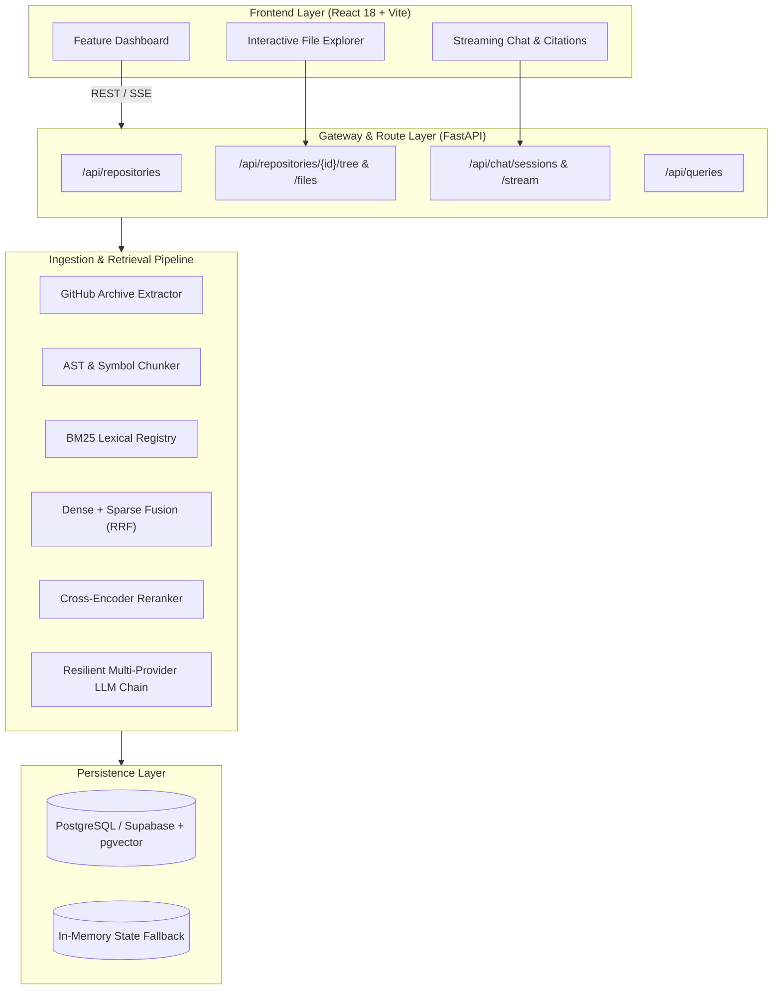

# CodeAtlas

> AI-powered repository intelligence engine providing conversational codebase exploration, AST-grounded search, and verified code citations.

---

## Overview

### Problem
Navigating unfamiliar, large-scale codebases is slow, fragmented, and mentally taxing. Developers frequently struggle to understand architectural patterns, track down symbol definitions, verify dependencies, and locate relevant logic without deep context switching. Standard LLM code assistants often hallucinate line numbers, misunderstand repository-wide relationships, or lack grounded codebase citations.

### Solution
**CodeAtlas** solves this by converting GitHub repositories into queryable, hybrid-indexed knowledge graphs. It extracts repository source code, parses Abstract Syntax Trees (ASTs) for function and class boundaries, indexes dense semantic embeddings alongside sparse BM25 indices, and provides an interactive dashboard with real-time token streaming and verified line-level source code citations.

### What the Project Does
* Ingests and extracts remote GitHub repositories asynchronously.
* Analyzes and chunks source code at AST symbol boundaries.
* Executes hybrid search (dense pgvector vector search + sparse BM25Okapi keyword search) merged via Reciprocal Rank Fusion (RRF) and Cross-Encoder reranking.
* Delivers answers with token-by-token Server-Sent Events (SSE) streaming and clickable line-level citations (`file:start_line-end_line`).
* Provides a full code browser with syntax highlighting and file tree navigation.

---

## Key Features

* **⚡ Multi-Stage Ingestion Pipeline**: Asynchronously downloads, filters non-code assets, chunks files via AST symbol parsing, and calculates content hashes for incremental deduplication.
* **🔍 Hybrid Concurrent Retrieval (RRF + Cross-Encoder)**: Combines dense vector similarity (`pgvector`) and sparse lexical retrieval (`BM25Okapi`), fused via Reciprocal Rank Fusion (RRF) and reranked using Cross-Encoder models.
* **🛡️ Validated Line-Level Citations**: Enforces strict grounding checks on generated answers to prevent hallucinations, attaching clickable references (`filepath:start_line-end_line`) to each source snippet.
* **💬 Real-Time SSE Chat Streaming**: Conversational chat interface backed by Server-Sent Events (SSE) for instantaneous token delivery and historical session management.
* **📂 Full-Featured File Tree & Syntax Browser**: Hierarchical repository explorer with language detection, line numbers, and active citation highlighting.
* **🗄️ Resilient Multi-Tier Persistence**: Enterprise-ready PostgreSQL / Supabase backend with graceful, non-blocking in-memory fallback for local development and CI testing.

---

## Architecture

The system follows a modular, decoupled architecture connecting a React single-page application (SPA) to a Python FastAPI backend orchestrated into specialized pipeline steps. For a complete deep-dive on component interactions and trade-offs, see [Architecture Documentation](docs/ARCHITECTURE.md).



### System Interactions
1. **Ingestion Flow**: `POST /api/repositories` downloads the remote GitHub archive, extracts text files, parses syntax trees into symbol-aware chunks, embeds chunks, and saves to database tables and hot in-memory BM25 indices.
2. **Retrieval Flow**: Questions are preprocessed and queried concurrently across dense vector embeddings and sparse lexical tokens. Results are blended via Reciprocal Rank Fusion ($RRF$) and scored by a Cross-Encoder reranker.
3. **Generation & Citation Flow**: Top code snippets form grounded prompts sent to the LLM chain (Gemini / Groq / Cerebras / OpenRouter). Output tokens stream via SSE, while citations are validated against actual line ranges before emitting the finalized message.

---

## Tech Stack

| Domain | Technology | Role |
| :--- | :--- | :--- |
| **Frontend UI** | React 18, TypeScript, Vite | Fast Single-Page Application (SPA) dashboard |
| **Styling & Icons** | CSS Custom Properties, Lucide Icons | Responsive UI design and iconography |
| **Code Highlighting** | Highlight.js | Source code rendering and syntax highlighting |
| **Backend Framework** | FastAPI, Python 3.12, Uvicorn | Asynchronous REST and Server-Sent Events (SSE) gateway |
| **Vector Search** | PostgreSQL, `pgvector`, PostgREST / Supabase | Dense vector storage and similarity search RPCs |
| **Sparse Lexical Search** | Rank-BM25 (`BM25Okapi`) | In-memory token-level keyword retrieval |
| **Embeddings** | Google Gemini (`text-embedding-004`) | 768-dimensional code representation |
| **LLM Inference** | Gemini 2.0 / Groq / Cerebras / OpenRouter | Resilient 4-tier conversational generation fallback |
| **Reranking** | Sentence-Transformers (`ms-marco-MiniLM-L-6-v2`) | Cross-encoder relevance scoring |
| **Testing** | Pytest, AnyIO, HTTPX ASGI Transport | Unit and integration test validation |

---

## Project Structure

The project is structured into clean domain modules, ensuring separation of concerns:

```
codeatlas/
├── backend/
│   ├── app/
│   │   ├── api/
│   │   │   ├── routes/              # Modular route handlers (repositories, files, chat, queries)
│   │   │   ├── dependencies.py      # Dependency injection factories
│   │   │   └── router.py            # API router aggregator
│   │   ├── database/                # PostgREST repositories, connections, and data models
│   │   ├── embeddings/              # Vector embedding services
│   │   ├── generation/              # Prompt builder, LLM client chain, citation validator
│   │   ├── ingestion/               # GitHub extractor, AST chunker, deduplicator, indexer
│   │   ├── retrieval/               # Query preprocessor, BM25 registry, RRF fusion, reranker
│   │   ├── schemas/                 # Pydantic request, response, and domain models
│   │   ├── services/                # Business logic services (repository, file, chat, query)
│   │   ├── shared/                  # Config, rate limiter, observability, logging, exceptions
│   │   └── main.py                  # Application entry point and middleware configuration
│   ├── supabase/migrations/         # PostgreSQL DDL, RPCs, and schema migrations
│   └── tests/                       # Unit and integration test suites
│
├── frontend/
│   └── src/
│       ├── app/                     # App entry point, routing, and shell layout
│       ├── features/
│       │   ├── repositories/        # Repository listing, creation, and monitoring
│       │   ├── chat/                # Real-time SSE chat, citations, and message bubbles
│       │   ├── files/               # Interactive file tree explorer and code viewer
│       │   └── overview/            # Repository metadata metrics and processing statistics
│       ├── services/api/            # Unified API fetch client and in-memory caches
│       ├── shared/                  # Reusable UI components, states, and hooks
│       └── styles/                  # Design tokens, reset rules, and global styles
```

---

## Getting Started

### Prerequisites
* **Python 3.12+**
* **Node.js 18+** & **npm**
* **Git**
* *(Optional)* Supabase project credentials for persistent PostgreSQL storage.

### 1. Clone the Repository
```bash
git clone https://github.com/your-org/codeatlas.git
cd codeatlas
```

### 2. Backend Setup
```bash
cd backend
python -m venv .venv

# Windows
.\.venv\Scripts\Activate.ps1
# Linux / macOS
source .venv/bin/activate

pip install -e .
```

### 3. Frontend Setup
```bash
cd ../frontend
npm install
```

---

## Environment Variables

Configure backend environment variables in a `.env` file inside `backend/` or export them in your shell:

| Variable | Description | Default | Required |
| :--- | :--- | :--- | :---: |
| `CODE_ATLAS_ENV` | Environment mode (`development`, `production`, `test`) | `development` | No |
| `CODE_ATLAS_GEMINI_API_KEY` | Google Gemini API key for embeddings and generation | `""` | Yes* |
| `CODE_ATLAS_SUPABASE_URL` | Supabase project REST URL | `""` | No (in-memory fallback) |
| `CODE_ATLAS_SUPABASE_SERVICE_ROLE_KEY` | Supabase service-role secret key | `""` | No (in-memory fallback) |
| `CODE_ATLAS_GITHUB_TOKEN` | GitHub Personal Access Token (prevents rate limits) | `""` | No |
| `CODE_ATLAS_GROQ_API_KEY` | Optional Groq fallback API key | `""` | No |
| `CODE_ATLAS_CEREBRAS_API_KEY` | Optional Cerebras fallback API key | `""` | No |
| `CODE_ATLAS_OPENROUTER_API_KEY` | Optional OpenRouter fallback API key | `""` | No |

Frontend configuration (`frontend/.env`):
| Variable | Description | Default | Required |
| :--- | :--- | :--- | :---: |
| `VITE_API_BASE_URL` | Target backend API base prefix | `/api` | No |

*\*Required for full live vector retrieval and generation; mock modes operate during unit tests.*

---

## Usage

### 1. Start the Backend API Server
```bash
cd backend
.\.venv\Scripts\Activate.ps1
uvicorn app.main:app --host 0.0.0.0 --port 8000 --reload
```
The API is available at `http://localhost:8000` (Swagger UI at `/docs`).

### 2. Start the Frontend Development Server
```bash
cd frontend
npm run dev
```
Open `http://localhost:5173` in your browser.

### 3. Explore a Repository
1. **Ingest**: Paste a public GitHub URL (e.g. `https://github.com/pallets/flask`) and click **Ingest**.
2. **Monitor**: Watch live status transitions (`downloading` &rarr; `filtering` &rarr; `chunking` &rarr; `indexing` &rarr; `ready`).
3. **Chat**: Ask natural-language questions (e.g. *"How does the routing decorator work?"*) to receive answers with line citations.
4. **Browse**: Click on any citation or navigate the **Files** tab to view the source code with active line highlighting.

---

## API Documentation

For complete parameter definitions, request bodies, error schemas, and response examples, refer to the [API Reference](docs/API.md).

### Core Endpoints Overview
* **Repositories**: `POST /api/repositories`, `GET /api/repositories`, `GET /api/repositories/{id}`
* **File Operations**: `GET /api/repositories/{id}/tree`, `GET /api/repositories/{id}/files/{filepath}`
* **Chat & Streaming**: `POST /api/chat/stream`, `GET /api/chat/sessions`, `GET /api/chat/sessions/{id}/messages`, `DELETE /api/chat/sessions`
* **Grounded Queries**: `POST /api/queries`
* **Health Check**: `GET /health`

### Further Documentation
* **[Architecture Guide](docs/ARCHITECTURE.md)**: Deep dive into the 7-stage ingestion pipeline, hybrid RRF retrieval, and LLM fallback chain.
* **[Database Documentation](docs/DATABASE.md)**: PostgreSQL schemas, `pgvector` HNSW index configuration, and SQL RPC procedures.
* **Interactive OpenAPI UI**: Start the server and visit `http://localhost:8000/docs`.

---

## Testing

### Backend Unit & Integration Tests
Execute the full test suite using `pytest`:
```bash
cd backend
.\.venv\Scripts\Activate.ps1
pytest -v
```

### Frontend Type-Checking & Production Build
Validate TypeScript typings and compile the production bundle:
```bash
cd frontend
npm run build
```

---

## Deployment

### Containerized Deployment (Docker)
Build and run the backend container:
```bash
cd backend
docker build -t codeatlas-backend .
docker run -p 8000:8000 --env-file .env codeatlas-backend
```

### Production Frontend Build
Compile the optimized static bundle:
```bash
cd frontend
npm run build
```
Deploy the output `dist/` directory to any CDN or static hosting service (Vercel, Netlify, Cloudflare Pages, NGINX). Configure reverse proxy routing from `/api` to the backend gateway at port `8000`.
