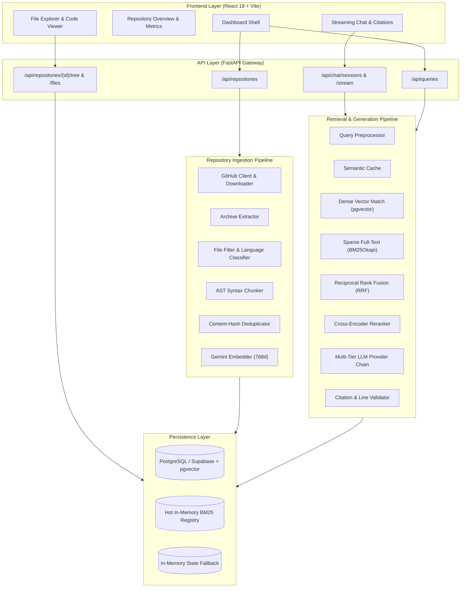
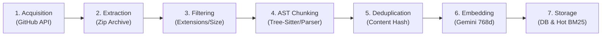
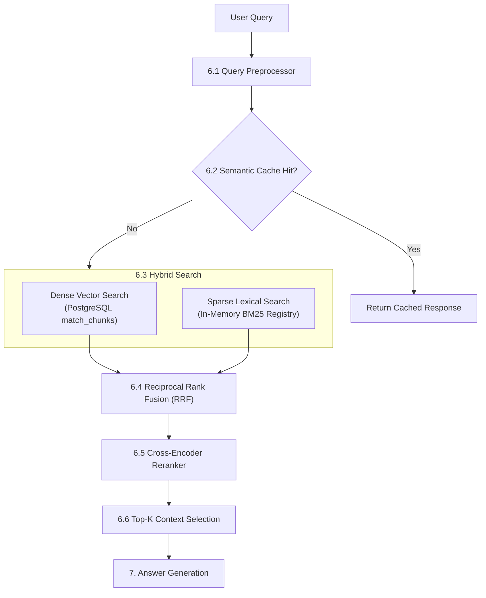
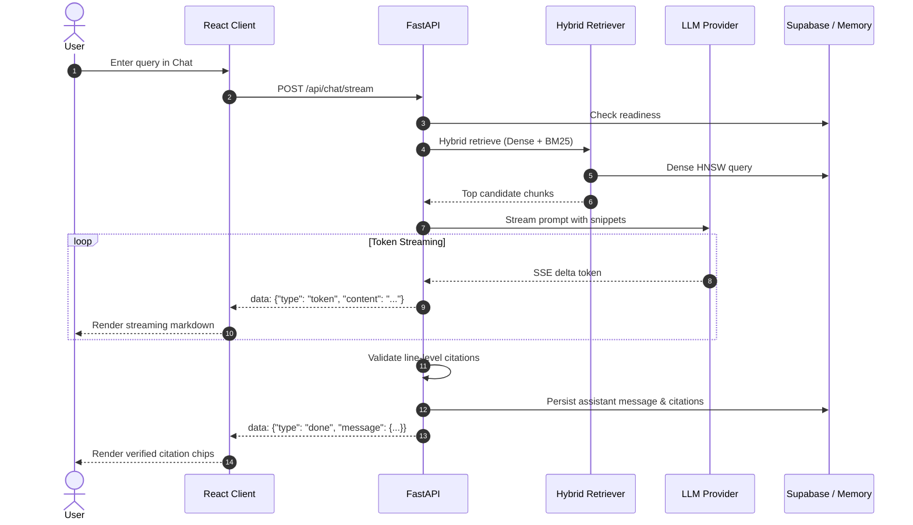

# Architecture

## 1. System Overview

CodeAtlas is a codebase intelligence engine designed to turn GitHub repositories into queryable, hybrid-indexed knowledge bases. Navigating large, unfamiliar codebases typically requires manually searching symbols, jumping between files, and guessing execution paths. CodeAtlas automates this understanding by combining Abstract Syntax Tree (AST) code chunking, hybrid dense/sparse retrieval, cross-encoder reranking, and grounded LLM generation with verified line-level source code citations.

The platform provides developers with an interactive web dashboard where they can submit repositories, track asynchronous ingestion stages in real time, query logic with token-by-token streaming, inspect clickable citations, and navigate an interactive syntax-highlighted code tree.

---

## 2. High-Level Architecture

CodeAtlas follows a decoupled client-server architecture consisting of a React Single-Page Application (SPA) frontend, an asynchronous FastAPI gateway backend, an ingestion pipeline, an intelligence retrieval pipeline, and a dual-tier persistence layer.

---

## 3. Technology Stack

* **Frontend Client**: React 18, TypeScript, Vite, CSS custom properties, Lucide Icons, Highlight.js.
* **Backend Framework**: Python 3.12, FastAPI, Uvicorn, Pydantic v2, HTTPX.
* **Lexical Indexing**: Rank-BM25 (`BM25Okapi`) with code compound token expansion.
* **Dense Vector Search**: PostgreSQL with `pgvector` extension via Supabase PostgREST and RPC functions.
* **Embedding Model**: Google Gemini (`text-embedding-004`), 768 dimensions.
* **Generation Providers**: Multi-tier fallback chain (Google Gemini 2.0 &rarr; Groq LLaMA 3.3 &rarr; Cerebras &rarr; OpenRouter).
* **Reranking**: Sentence-Transformers Cross-Encoder (`ms-marco-MiniLM-L-6-v2`).
* **Test Harness**: Pytest, AnyIO, HTTPX ASGI Transport.

---

## 4. Application Components

### 4.1 Frontend
The client application is organized into feature-driven modules under `frontend/src/features/`:
* **Repositories**: Manages repository ingestion submissions, live status polling, and summary metrics.
* **Chat**: Manages conversational message sessions, real-time Server-Sent Events (SSE) stream consumption, and interactive citation chips.
* **Files**: Renders the hierarchical repository directory tree, file selection, and syntax-highlighted source code with active citation jump targets.
* **Overview**: Summarizes repository committers, language distribution, processing duration, and indexing health.

### 4.2 Backend
The backend is structured into modular layers adhering to Single Responsibility:
* **API (`app/api/`)**: Defines routers (`repositories`, `files`, `chat`, `queries`) and dependency injection providers.
* **Services (`app/services/`)**: Orchestrates core business domain logic (`IngestionService`, `RepositoryService`, `FileService`, `ChatService`, `QueryService`).
* **Ingestion (`app/ingestion/`)**: Implements deterministic, step-by-step ingestion stages (download &rarr; extract &rarr; filter &rarr; parse &rarr; chunk &rarr; deduplicate &rarr; index).
* **Retrieval (`app/retrieval/`)**: Contains hybrid retrieval, tokenization, BM25 indexing, RRF fusion, and semantic caching.
* **Generation (`app/generation/`)**: Contains prompt construction, provider fallback dispatch, and citation verification.
* **Shared (`app/shared/`)**: Application configuration, rate limiters, structured logging, safe observability, and custom domain exceptions.

### 4.3 Database
PostgreSQL with the `pgvector` extension hosted on Supabase:
* Manages relational repository state, code chunks, and metadata.
* Executes vector cosine similarity searches and full-text searches via dedicated SQL stored procedures (`match_chunks`, `search_chunks`, `match_semantic_cache`).
* Implements cascading foreign keys and row-level security.

### 4.4 External Services
* **GitHub API & Raw Content**: Fetches commit details, contributor lists, archive downloads, and live file contents.
* **Gemini API**: Generates dense vector embeddings and primary conversational responses.
* **Groq / Cerebras / OpenRouter**: Serves as automatic fallback LLM inference endpoints when upstream rate limits or quota thresholds are met.

---

## 5. Repository Ingestion Pipeline

The ingestion pipeline transforms raw repository archives into searchable chunks via an asynchronous sequential pipeline:

### 5.1 Repository Acquisition
The pipeline validates the repository URL, resolves the default branch, and retrieves commit metadata and top contributors via `GitHubClient`. Ingestion begins asynchronously upon returning an `HTTP 202 Accepted` response.

### 5.2 Archive Extraction
`ArchiveExtractor` downloads a compressed tarball or zipball from GitHub into an isolated temporary working directory. Streaming archive extraction minimizes memory overhead.

### 5.3 File Filtering
`FileFilter` walks the extracted tree and filters out binaries, lock files, minified assets, vendored directories (`node_modules/`, `.git/`, `dist/`, `venv/`), and files exceeding size thresholds (default 256 KB), preserving only pertinent source code and documentation.

### 5.4 AST-Based Chunking
`ASTChunker` parses source files into logical syntactical units. Rather than arbitrary character-count splitting, chunk boundaries align with classes, functions, and method signatures, preserving symbol context, imports, start lines, and end lines.

### 5.5 Content Deduplication
`ChunkDeduplicator` calculates a SHA-256 hash (`content_hash`) of each chunk's stripped content. It queries existing hashes in PostgreSQL to separate new chunks from identical chunks already indexed across previous ingestions or shared files, skipping redundant vector embedding generation.

### 5.6 Embedding Generation
`EmbeddingService` batches new chunk texts and generates 768-dimensional vector representations using Google Gemini `text-embedding-004`.

### 5.7 Database Storage
`ChunkIndexer` executes batch upserts into `chunks` and `chunk_metadata`, updates repository statistics (duration, chunks created, embeddings generated), transitions status to `ready`, and hydrates the hot in-memory `BM25Registry`. Temporary raw extraction directories are pruned immediately.

---

## 6. Retrieval Pipeline

### 6.1 Query Preprocessing
`QueryPreprocessor` cleans the incoming raw text, extracts programming keywords, and generates a query embedding vector via Gemini.

### 6.2 Semantic Cache
`SemanticCache` computes a query embedding cosine similarity check against previously answered questions stored in `semantic_cache`. Matches with similarity $\ge 0.92$ return immediately with $<50\text{ ms}$ latency, bypassing downstream retrieval and LLM inference.

### 6.3 Hybrid Retrieval
If no cache entry matches, `HybridRetriever` runs concurrent dual-path retrieval:
1. **Dense Retrieval**: `DatabaseRepository.dense_search` calls `match_chunks` in PostgreSQL to fetch the top 20 nearest neighbors by cosine similarity.
2. **Sparse Retrieval**: `BM25Registry.query` scores documents using tokenized $BM25Okapi$ across code tokens and sub-tokens.

### 6.4 Reciprocal Rank Fusion
`RRFFusion` merges the disparate score scales of dense and sparse results using rank-based weighting:
$$RRF(d) = \sum_{m \in \{\text{dense}, \text{sparse}\}} \frac{w_m}{k + \text{rank}_m(d)}$$
where $k=60$ dampens rank outliers.

### 6.5 Reranking
`CrossEncoderReranker` scores the top fused candidate chunks together with the query text using the `ms-marco-MiniLM-L-6-v2` cross-encoder. This captures cross-attention semantics between the user's intent and specific code statements.

### 6.6 Context Selection
The top $K$ reranked chunks (default $K=5$) are filtered and formatted for context assembly. If no chunks pass relevance thresholds, an empty-retrieval fast exit occurs immediately, preventing hallucination.

---

## 7. Answer Generation

### 7.1 Context Construction
`PromptBuilder` injects retrieved snippets into a strictly bounded system instruction. Each snippet is labeled with its index, relative filepath, line bounds, and symbol metadata. The model is explicitly constrained to rely exclusively on the provided code blocks.

### 7.2 LLM Provider Fallback
`LLMClientChain` executes an automated 4-tier provider failover:
1. **Google Gemini** (`gemini-2.0-flash`)
2. **Groq** (`llama-3.3-70b-versatile`)
3. **Cerebras** (`llama3.1-70b`)
4. **OpenRouter** (Unified multi-provider fallback)

If the primary provider encounters HTTP 429 rate limits, quota exhaustion, or timeouts, the chain seamlessly fails over to the next provider within milliseconds.

### 7.3 Citation Generation
The prompt requires the LLM to ground assertions in explicit citation tokens: `[filepath:start_line-end_line]` or `[filepath:line]`.

### 7.4 Response Validation
`CitationValidator` parses generated citation tokens with regex and validates them against the actual line ranges of retrieved chunks. Citations pointing to non-existent files or fabricated lines are filtered out, leaving only genuine references.

---

## 8. Data Flow

---

## 9. Error Handling and Fallback Mechanisms

* **Database Degradation**: `DatabaseConnection` and `ChatSessionManager` catch PostgreSQL/PostgREST connection failures gracefully, preserving state in an in-memory cache and logging warnings without interrupting live user requests.
* **LLM Resilience**: `LLMClientChain` wraps network and status errors, failing over sequentially across 4 distinct providers.
* **Empty Retrieval Guard**: When queries do not match indexed repository content, `ResponseGenerator` triggers an instant non-hallucinatory exit message, bypassing token generation costs.
* **GitHub Rate Limiting**: `GitHubClient` detects HTTP 403 rate limits and surfaces friendly instructions for personal access token configuration.

---

## 10. Architectural Decisions and Trade-offs

1. **AST Chunking vs. Fixed-Character Window**:
   * *Decision*: Parse AST symbols rather than splitting every 500 characters.
   * *Trade-off*: Slower initial parsing, but completely eliminates severed functions and fragmented syntax that break embeddings and citations.
2. **Hybrid RRF (Dense + Sparse) vs. Dense Only**:
   * *Decision*: Run parallel dense vector search alongside in-memory BM25Okapi.
   * *Trade-off*: Memory consumption for BM25 corpus tokens in exchange for high-precision retrieval on exact symbol names, identifiers, and error strings that vector embeddings blur.
3. **On-Demand Raw File Fetch vs. Full Database Source Duplication**:
   * *Decision*: Retrieve full file contents on-demand from GitHub (with chunk reconstruction fallback) rather than storing full multi-megabyte source trees in PostgreSQL.
   * *Trade-off*: Dependency on external GitHub availability, but prevents database bloat and ensures database storage stays compact.
